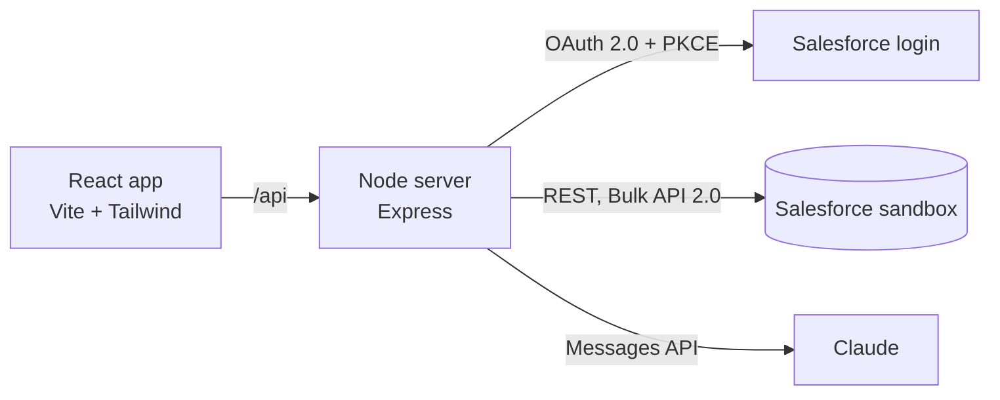

# Salesforce sandbox layer

## Goal

Build a web app that connects to a Salesforce **sandbox** and adds features Salesforce
doesn't provide out of the box, or makes clunky. It works alongside Salesforce, not
instead of it: Salesforce stays the system of record, and every change the app makes
goes through the standard Salesforce APIs, so validation rules, sharing, and audit
history still apply.

There are two ways to run it:
- **Local mode** connects to the real sandbox from the developer's Mac.
- **Showcase mode** runs on the public demos site with made-up sample data and no
  connection to any org.

## Guardrails

These apply to every milestone:

- **Sandbox only.** The app refuses to sign in to a production org. It checks the
  login host and the org's `IsSandbox` flag after sign-in.
- **No org details in public.** The org's name, URLs, and keys live only in
  `app/.env`, which git ignores. This page and the repo stay generic.
- **No real data in showcase mode.** The public demo uses generated sample data only.
- **Sign-in is per user.** Each person signs in with their own Salesforce login (OAuth),
  so the app sees only what that user is allowed to see. There are no shared service
  passwords.
- **AI needs approval.** Sending org data to an external AI service needs the firm's
  approval first. Until then, the AI assistant only runs in showcase mode on sample data.

## Architecture

- **Frontend:** the React app in `app/` (Vite, TypeScript, Tailwind CSS), built as a demo
  in the demos gallery.
- **Backend:** a small Node server (Express) next to it. It handles sign-in, keeps the
  Salesforce tokens in a server-side session (never in the browser), and forwards API
  calls. It also avoids browser CORS limits against Salesforce.
- **Connection:** an **External Client App** in the sandbox (Salesforce's successor to
  Connected Apps), using the OAuth 2.0 web server flow with PKCE. Scopes: `api`,
  `refresh_token`.
- **Salesforce APIs:** REST API and SOQL for reads, Composite API for small batches of
  changes, Bulk API 2.0 for large jobs, and the UI API for record layouts and picklists.
- **AI:** the Claude Messages API, called only from the server, with tool calls that run
  read-only SOQL on the user's behalf.
- **Showcase mode:** a data adapter interface with two implementations, `live`
  (Salesforce) and `mock` (sample data), chosen at build time. The public build only
  includes `mock`.

## Feature areas

Candidate features in each area. These still need confirming, and need to be ranked by value.

### 0. Customizable record pages (first feature, in progress)

The standard Financial Services Cloud Wealth Management Account page is cluttered.
Three equal columns compete for attention. Empty components (Alerts with no alerts,
an empty Interaction Summaries illustration, Business Milestones) take up full blocks.
The Action Launcher uses a whole card for one search box. Key details are squeezed
into a narrow column.

The redesign:
- **Header** with the record's identity, an **Actions** menu (replaces the Action
  Launcher card), and up to four **pinned fields** each user picks.
- **Alerts** only appear, as a thin banner, when there is an alert.
- **Details take the main column**, as collapsible sections with tabs for Activity
  and Milestones.
- **Side panel** for related lists and FSC components. Empty ones shrink to one line.
- **Per-user customization**: show or hide any field, pin fields, reorder sections,
  show or hide side-panel components, hide empty fields, compact or comfortable
  density, and presets (Advisor, Operations, Everything).

Salesforce has no per-user field choice: Dynamic Forms visibility is set by admins
with rules. That makes this a good fit for the layer.

**Live mode (Salesforce API):**
- *Field list:* `ui-api/object-info/Account`, so custom fields appear automatically.
  Only fields the user has access to are returned.
- *Record values:* `ui-api/records/{id}`.
- *Related lists:* `ui-api/related-list-records`.
- *Saving preferences:* per user, in Salesforce, so they follow the user across
  devices. Candidates are a small custom object (`Layout_Preference__c`, one record
  per user and object, holding the settings as JSON) or a hierarchy custom setting.
- *Edits:* go back through `ui-api/records` (PATCH), so validation rules still apply.

The showcase version uses fictional data and saves preferences in the browser.

### 1. Dashboards and analytics
- Pipeline by stage and owner, showing win rate, average deal size, and sales-cycle length
- Pipeline changes over time: what moved, slipped, or closed this week
- Account health score combining activity recency, open cases, and opportunity trend
- Drill down from any chart straight to the underlying records

### 2. Bulk data tools
- Find duplicate Accounts and Contacts with fuzzy matching, review them side by side,
  then merge
- Data quality report: missing required-by-convention fields, stale records, bad formats
- Spreadsheet-style editing across many records, with a preview of changes before saving
- CSV import with field mapping and a dry run, using Bulk API 2.0 with a per-row error report

### 3. AI assistant
- Ask questions about the org's data in plain English ("which accounts in the Northeast
  haven't been contacted in 90 days?"), answered with the query it ran shown
- One-paragraph account briefing before a meeting
- Draft follow-up emails from recent activity (drafts only, never sent automatically)
- Explain a record's history: what changed, when, and who changed it

### 4. Custom workflows
- Step-by-step guided screens for multi-object processes (for example, onboarding a new
  client: Account, then Contacts, then Opportunity, then Tasks)
- Checklists that create follow-up Tasks automatically
- Approval and review queues across objects in one view

## Milestones

1. **Foundation.** Add the Node server, OAuth sign-in to the sandbox, the
   production guard, a "who am I / which org" screen, and the mock data adapter.
   Register the demo in the gallery.
2. **First dashboard.** Pipeline analytics, live and mock.
3. **First bulk tool.** Duplicate finder, starting read-only, then with merge.
4. **AI assistant (mock data).** Natural-language questions over sample data, with the
   query shown.
5. **First guided workflow.** The client-onboarding flow.
6. **Review.** Tidy up, write an artefact page summarising results, and decide what's next.

Each milestone ships to the demos site in showcase mode.

## Setup needed from the admin

1. The sandbox's login URL (it contains `--` and `.sandbox.my.salesforce.com`).
2. An External Client App created in the sandbox:
   - callback URL `http://localhost:5174/api/auth/callback`
   - OAuth scopes `api` and `refresh_token`
   - PKCE required
   - the consumer key copied into `app/.env`
3. The objects and fields that matter most. Standard objects only, or custom ones too?

## Open questions

- Which two or three features in each area matter most?
- Who uses it: only the admin, or a wider team? This decides whether the app ever needs
  hosting beyond a single Mac.
- Is the firm likely to approve sending sandbox data to an external AI service, or should
  the AI assistant stay on sample data?
- Are there custom objects (for example financial-account or household objects) that
  dashboards should cover?
